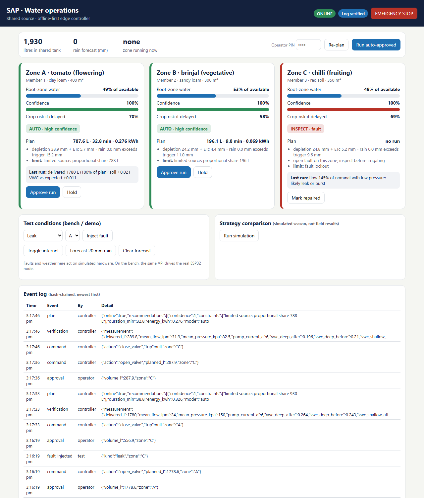

# SAP — offline-first water operations for farms sharing one source

SAP helps a group of small farms (for example an FPO cluster on one borewell or tank) decide **where limited water should go, deliver it safely even without internet, and verify that it reached the root zone**.

Student venture · Sri Sairam Engineering College, Chennai · Wadhwani Foundation Ignite.

## What is in this repository

| Module | What it does |
|---|---|
| `sap/models.py` | Data entities: zone, crop, soil, source, sensor reading, recommendation, measurement, verification |
| `sap/estimator.py` | Interpretable FAO-56 style root-zone water balance per zone, with a **confidence score and stated reasons** (sensor disagreement, missing depth, stale reading, stale forecast) |
| `sap/allocator.py` | Shares limited water across zones by crop risk and agreed priority, within source reserve, pump, run-time and energy limits. Chooses a mode: `auto`, `needs_approval`, `conservative`, `inspect`, `hold` |
| `sap/safety.py` | Local interlocks for every run: emergency stop, manual override, source reserve, dry-run (pump current), overcurrent, low/high flow, pressure collapse |
| `sap/verify.py` | After each run: did the planned water flow, and did soil respond as predicted? Flags likely leak, blockage, stuck valve, dry-run, sensor fault or ineffective irrigation |
| `sap/eventlog.py` | Append-only, SHA-256 hash-chained log of recommendations, approvals, commands and results; tampering is detectable |
| `sap/simulator.py` | Compares fixed timer, single moisture threshold and SAP on the same synthetic season with injected faults |
| `sap/controller.py` | Edge controller: daily plan, approvals, safe execution, verification, fault lockout (simulated hardware for demos) |
| `sap/server.py` + `dashboard/index.html` | Local web dashboard and JSON API (stdlib only) — works on farm Wi-Fi with no internet; PIN-protected actions |
| `firmware/sap_node/sap_node.ino` | ESP32 node: pump/valve relays, flow, pressure, pump current, tank level, 2-depth soil, e-stop; enforces safety limits itself, incl. controller-heartbeat loss |
| `tests/test_sap.py` | Unit tests for estimation, allocation, safety, verification, the log and the simulator |



*Dashboard with simulated hardware: a leak was injected on zone C, detected after the run and the zone locked for inspection.*

## Quick start

```bash
python3 -m sap.server             # dashboard at http://localhost:8080 (PIN 1234, set SAP_PIN)
python3 -m sap.simulator          # run the strategy comparison
python3 -m pytest -q              # run the tests (pip install pytest)
```

Python 3.10+, no third-party runtime dependencies.

## Decision flow

1. Read 2-depth soil moisture, weather forecast, source level.
2. Estimate each zone's need and confidence (`estimator.py`).
3. Plan allocation under source/pump/energy limits and agreed priorities (`allocator.py`).
4. High confidence → run automatically; medium → operator approval; low → conservative run or hold; open fault → inspect.
5. Execute on the local controller with interlocks (`safety.py`) — works offline.
6. Verify delivery and soil response; classify faults (`verify.py`).
7. Log everything in a tamper-evident chain (`eventlog.py`); sync when online.

## Honest status

* **Simulation only.** The simulator uses a simple daily soil bucket and synthetic weather. Its numbers test the logic; they are **not** evidence of water savings or accuracy.
* **The firmware has not been run on real hardware.** The dashboard uses simulated hardware (`FakeHardware`). Calibrate sensors on the bench first and have an electrician wire any mains pump.
* No field data yet. ML is deliberately not used until there is data, an evaluation plan and a fallback.
* Thresholds (confidence cut-offs, fault ratios) are starting assumptions to be calibrated on the bench prototype and in a control-plot field trial.
* A patent/novelty search has not been done; no novelty is claimed.

## Next steps

* Bench prototype: 2 zones, shared tank, pump, valves, flow + pressure + pump-current sensing, ESP32/Raspberry Pi controller.
* SMS/WhatsApp approvals (the local web dashboard already exists).
* Field trial with paired SAP and control plots and an agronomist rating crop condition.
